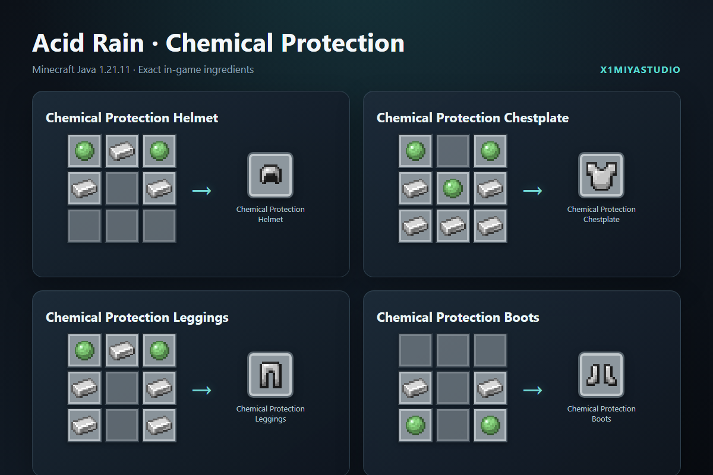

# Acid Rain

Acid Rain turns ordinary weather into a configurable survival hazard. Find shelter, craft chemical protection, and watch your armor corrosion when the sky turns dangerous.

## Features

- Configurable chance for rain to become acid rain.
- Outdoor damage for Survival and Adventure players.
- Four-piece chemical protection set with custom recipes.
- Armor corrosion, warnings, particles, sounds, and durability feedback.
- `Unbreaking` reduces corrosion chance.
- Creative and Spectator players are ignored.

## Crafting

## Commands

- `/function x1miya:acid_rain/status`
- `/function x1miya:acid_rain/force_start`
- `/function x1miya:acid_rain/force_stop`
- `/function x1miya:acid_rain/reset`
- `/function x1miya:acid_rain/uninstall`

## Installation

Place the ZIP in `<world>/datapacks/`, then run `/reload`.

Minecraft Java Edition **1.21.11** · Vanilla datapack · Namespace `x1miya` · X1miyaStudio
