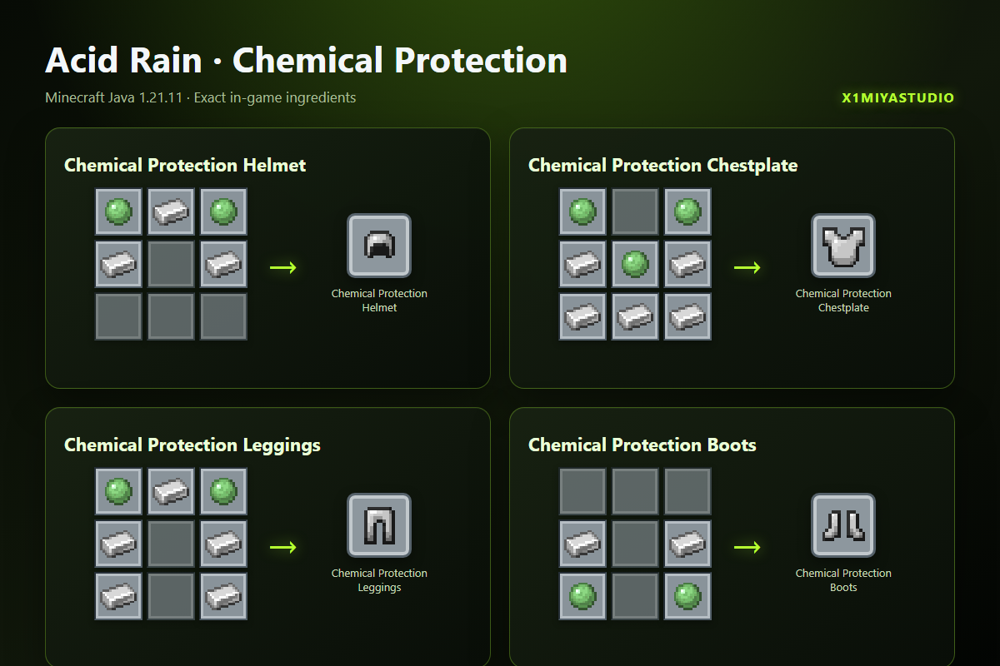

# Кислотный дождь

Кислотный дождь превращает обычную погоду в настраиваемую угрозу для выживания. Ищи укрытие, создавай химическую защиту и следи за коррозией брони.

## Возможности

- Настраиваемый шанс превращения дождя в кислотный.
- Урон игрокам в режимах Выживание и Приключение под открытым небом.
- Комплект химзащиты из четырёх предметов с собственными рецептами.
- Коррозия брони, предупреждения, частицы, звуки и визуальная прочность.
- Зачарование `Прочность` снижает шанс коррозии.
- Игроки в Творческом режиме и Наблюдатели игнорируются.

## Крафты

## Команды

- `/function x1miya:acid_rain/status`
- `/function x1miya:acid_rain/force_start`
- `/function x1miya:acid_rain/force_stop`
- `/function x1miya:acid_rain/reset`
- `/function x1miya:acid_rain/uninstall`

## Установка

Помести ZIP в `<мир>/datapacks/`, затем выполни `/reload`.

Minecraft Java Edition **1.21.11** · Ванильный датапак · Namespace `x1miya` · All Rights Reserved · X1miyaStudio
